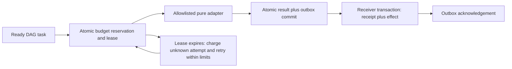

# Agent Replay Lab

**A workflow should survive a stopped worker without forgetting what already happened.**

I built a small recovery harness to make that claim testable. It runs a four-task dependency graph and simulates a worker restart by orderly closing and reopening database connections at specific execution boundaries within the same Python process. It records the work and effects that happen afterward. SQLite holds the workflow, leases, budget reservations, and outbox; a second database represents a destination that supports durable deduplication.

This is an original engineering portfolio experiment by Vedant Thaker. The adapters are deterministic Python functions. There are no model calls, cloud deployments, paid services, or customer records.

## The decision behind the project

An agent loop can look correct while it remains in one process. The difficult question is what happens after a result is computed, after a result is committed, or after a destination accepts an event but the sender misses the acknowledgement.

My approach is **reserve → lease → execute → commit → deliver → reconcile**. Each step has a storage boundary and a failure case. A retry can repeat computation; it must not silently overwrite a newer worker's state or spend the same remaining budget twice.



## Measured result

The checked-in [raw result and full traces](results/fault-replay.json) come from five fixed scenarios. Each fault occurs once, at the second task. All four durable tasks finish in every scenario, with four unique receiver effects and no duplicate effects.

| Injected boundary | Adapter calls: in-memory / durable | Duplicate effects: in-memory / durable |
|---|---:|---:|
| No fault | 4 / 4 | 0 / 0 |
| After claim, before adapter | 5 / 4 | 1 / 0 |
| After adapter, before commit | 6 / 5 | 1 / 0 |
| After committed result | 6 / 4 | 2 / 0 |
| Receiver accepts, sender misses acknowledgement | 6 / 4 | 2 / 0 |

In the last scenario, the receiver rejects one repeated delivery through its persisted inbox. A separate lease race probe rejects the expired worker's completion after a replacement receives a higher fencing token. The in-memory comparison intentionally loses its completion map on restart and sends effects directly; it is a simple failure demonstration, not a comparison against a mature orchestration product.

The useful outcome is an inspectable recovery contract. The experiment does **not** estimate a production failure rate, throughput, latency, model quality, token savings, or dollar savings. Five hand-selected cases do not establish general reliability.

## Run it

Python 3.11 or later; standard library only. Run from this repository's root:

```bash
python -m unittest discover -s tests -v
python -m replaylab experiment
python -m replaylab run --state-dir .runtime/demo
python -m replaylab run --state-dir .runtime/demo
```

The last command resumes the same workflow. Already completed tasks remain completed; the receiver still contains four effects. The experiment uses temporary databases and a deterministic logical clock, then writes the JSON artifact. The interactive run uses the local wall clock and leaves state under the ignored `.runtime/` directory.

## What is enforced

- A dependency cycle, missing dependency, duplicate task name, or non-allowlisted adapter is rejected before creating the workflow.
- SQLite `BEGIN IMMEDIATE` serializes claims and reservation changes. The run's `spent + reserved` cannot exceed its declared budget.
- Every attempt reserves its declared maximum cost before execution. A lost attempt is charged conservatively at lease expiry; its work may or may not have run. Retries consume a new reservation and stop at `max_attempts` or an insufficient remaining budget.
- Completion requires the stored worker and fencing token plus an unexpired lease. An identical completed result can be acknowledged again; a different result cannot replace it.
- A completed result and its outbox event commit together. The receiver's inbox receipt and local effect also commit together. Redelivery after a lost acknowledgement is safe for this receiver.
- Non-transient adapter errors stop retries and block descendants. NaN, infinity, booleans, negative clocks, invalid lease durations, and backward workflow clocks are rejected.

`claim()` returning `None` means no task is currently admissible. It can mean completion, a live lease, failed dependencies, or insufficient remaining budget; callers must inspect the snapshot rather than interpret it as success.

## Read the implementation

| File | Purpose |
|---|---|
| [engine.py](replaylab/engine.py) | State transitions, fencing, accounting, outbox, receiver |
| [experiment.py](replaylab/experiment.py) | Baseline, five injected faults, stale-worker probe, source digests |
| [workflow.json](data/workflow.json) | Four-task original fixture and declared attempt costs |
| [tests](tests/) | Concurrent claims, restart recovery, atomic rollback, retry and budget boundaries |
| [case study](docs/case-study.md) | Design choices, tradeoffs, and what I would change next |
| [provenance](docs/provenance.md) | Reference credits, authorship, and evidence boundaries |

## Limits that affect a real integration

Adapters are trusted, allowlisted, pure functions. The registry prevents arbitrary command selection; it is not a sandbox for hostile Python. There is no heartbeat, authorization layer, network service, multi-host clock synchronization, or distributed database. The SQLite deployment assumes one shared local filesystem and a consistent nondecreasing clock; wall-clock jumps can stop progress. Fencing protects committed workflow state, not an external side effect that an expired worker sends independently.

The receiver demonstrates atomic local effects. It does not provide exactly-once email, payments, or arbitrary HTTP requests. A real destination needs its own idempotency protocol and reconciliation process. Synthetic budget units constrain admitted attempts under the supplied worker protocol. `Claim.execute()` is a callable, not a metered sandbox: a custom worker can invoke it multiple times. These units are not provider billing or token enforcement. A production integration would need validated upper bounds, cancellations, metering, and reconciliation with the actual provider.

## References

ECC's bounded loops, explicit evaluation criteria, and verification practices motivated the questions, rather than this implementation. The exact conceptual sources and MIT attribution are recorded in [provenance](docs/provenance.md). SQLite's transaction and isolation documentation informs the storage design: [transactions](https://www.sqlite.org/lang_transaction.html), [isolation](https://www.sqlite.org/isolation.html).
